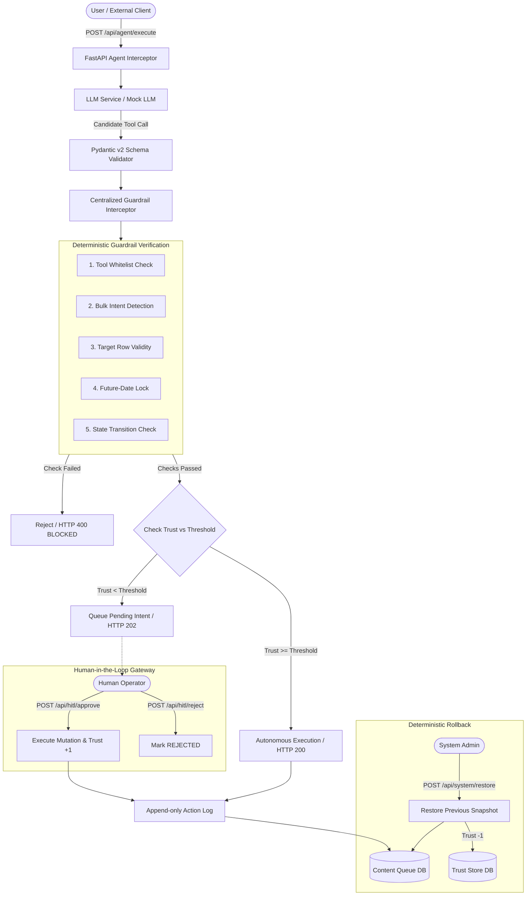
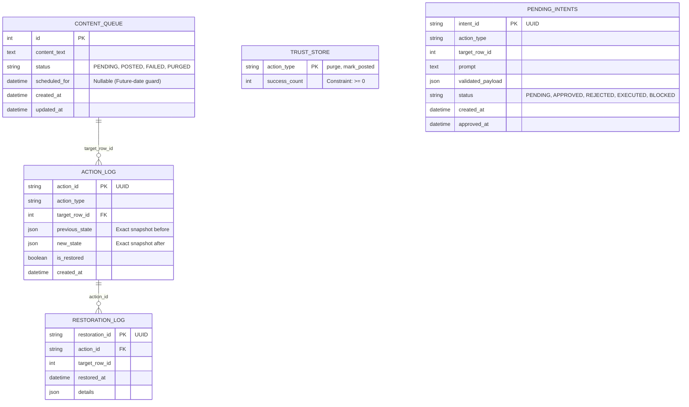
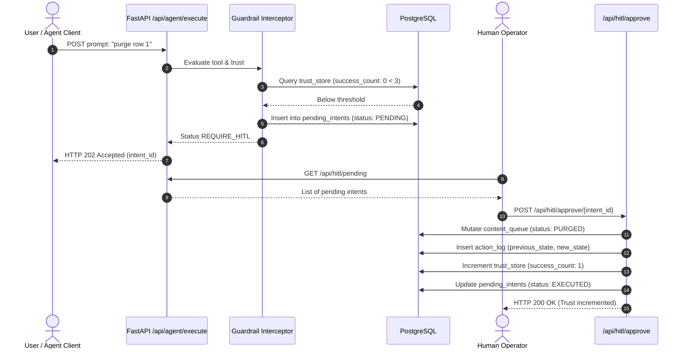

# AI Agent Harness – Trust-Based Progressive Autonomy with Human-in-the-Loop Guardrails

[](https://fastapi.tiangolo.com)
[](https://www.sqlalchemy.org/)
[](https://docs.pydantic.dev/)
[](https://www.postgresql.org/)
[](https://www.docker.com/)
[]()

A production-quality security harness that safely orchestrates AI agent interactions with external systems and databases. Potentially destructive mutations are bounded by **deterministic application-level guardrails**, **Human-in-the-Loop (HITL) approval gates**, **earned progressive autonomy**, and **append-only deterministic rollbacks with trust penalties**.

---

## 1. Project Overview

Autonomous AI agents executing arbitrary actions against enterprise data risk inadvertent corruption, unauthorized mass deletions, or irreversible state transitions. The **AI Agent Harness** solves this by establishing a zero-trust intermediary layer between LLMs and target databases.

The system ensures that **no LLM ever executes database mutations directly**. Every tool call undergoes schema validation, whitelist filtering, precondition and date checks, and trust-level inspection. Actions only earn autonomy after consistent, human-approved track records.

---

## 2. Problem Statement

Deploying AI agents in production environments presents critical safety challenges:
- **Unbounded Destructive Power:** Prompts like *"Purge everything immediately"* can trigger cascading deletions if delegated to naive agents.
- **Premature Autonomy:** Agents given blanket permissions may act unexpectedly on edge cases.
- **Lack of Reversibility:** Most agent architectures lack state snapshotting and deterministic rollback capabilities.
- **Non-Deterministic Security:** Letting an LLM decide whether an action is safe or whether approval is needed violates core security principles.

---

## 3. Core Objectives

1. **Deterministic Isolation:** Strictly decouple LLM tool output generation from database execution logic.
2. **Progressive Autonomy:** Gate unproven actions behind human approval; automatically transition actions to autonomous execution only after reaching a configurable trust threshold (`TRUST_THRESHOLD`).
3. **Defense Against Bulk Mutations:** Intercept and block mass destructive requests regardless of phrasing.
4. **Append-Only Auditing:** Capture exact before-and-after state snapshots in an immutable action log.
5. **Rollback with Accountability:** Support transactional restoration of affected rows while penalizing trust counters to prevent unearned autonomy.
6. **Zero-Secret Offline Testing:** Full offline functionality with deterministic mock LLM mode (`MOCK_LLM_ENABLED=true`).

---

## 4. System Architecture



---

## 5. Technology Stack

| Category | Technology | Version / Specification |
|---|---|---|
| **Language** | Python | 3.10+ / 3.11+ |
| **API Framework** | FastAPI | 0.115.6 |
| **Web Server** | Uvicorn | 0.34.0 |
| **Database** | PostgreSQL | 16 (with SQLite test fallback) |
| **ORM** | SQLAlchemy | 2.0.36 |
| **Migrations** | Alembic | 1.14.1 |
| **Data Validation** | Pydantic v2 | 2.10.4 |
| **LLM Provider** | OpenAI API & Deterministic Mock LLM | gpt-4.1-mini / Local Mock |
| **Testing** | Pytest & HTTPX | pytest 8.3.4, httpx 0.28.1 |
| **Browser Automation** | Playwright | 1.49.1 / 1.65.2 |
| **Containerization** | Docker & Docker Compose | Multi-stage image with Postgres 16 |

---

## 6. Database Schema

The database model is implemented via SQLAlchemy and managed through Alembic migrations:



---

## 7. Trust-Based Progressive Autonomy

Autonomy is earned dynamically per action type (`purge`, `mark_posted`):

- **Baseline Trust (0):** All actions begin untrusted.
- **Trust Increment:** Each time a human reviews and approves an action via `POST /api/hitl/approve/{intent_id}`, the corresponding `success_count` increments by **exactly 1**.
- **Autonomy Transition:** Once `success_count >= TRUST_THRESHOLD` (default: 3), identical action types bypass HITL and execute autonomously with HTTP 200.
- **Trust Penalty:** If an action is rolled back via `POST /api/system/restore`, the trust count decrements by **exactly 1** (bounded at 0 floor).

---

## 8. Human-in-the-Loop (HITL) Workflow



---

## 9. Action Logging and Rollback

Every state mutation generates an append-only `ActionLog` record containing exact JSON snapshots:

```json
{
  "action_id": "59ba14cb-3614-4e05-8c37-c8f10f91139c",
  "action_type": "purge",
  "target_row_id": 1,
  "previous_state": {
    "id": 1,
    "content_text": "First standard queued announcement.",
    "status": "PENDING"
  },
  "new_state": {
    "id": 1,
    "content_text": "First standard queued announcement.",
    "status": "PURGED"
  },
  "is_restored": false
}
```

When `/api/system/restore` is called:
1. `previous_state` is restored into `content_queue`.
2. A record is added to `restoration_log`.
3. `is_restored` is set to `true`.
4. Trust is decremented by 1.
5. Repeated calls are idempotent (no repeated penalty).

---

## 10. API Documentation

Interactive Swagger documentation is available at `http://localhost:8000/docs`.

| Method | Endpoint | Description | Status Codes |
|---|---|---|---|
| `GET` | `/` | API welcome, environment info, settings | `200` |
| `GET` | `/health` | Application and database health check | `200` |
| `POST` | `/api/agent/execute` | Process agent prompt through harness | `200`, `202`, `400` |
| `GET` | `/api/hitl/pending` | List all pending HITL intents | `200` |
| `POST` | `/api/hitl/approve/{intent_id}` | Approve and execute pending action | `200`, `400`, `404` |
| `POST` | `/api/hitl/reject/{intent_id}` | Reject pending action | `200`, `400`, `404` |
| `POST` | `/api/system/restore` | Rollback action and penalize trust | `200`, `400`, `404` |
| `GET` | `/api/system/actions` | Audit log history of all mutations | `200` |
| `GET` | `/api/system/trust` | Inspect trust scores per action type | `200` |
| `GET` | `/api/system/queue` | Inspect content queue items & statuses | `200` |

---

## 11. Installation & Environment Setup

### Prerequisites
- Python 3.10+ or 3.11+
- Git

### Local Setup
```powershell
# 1. Clone repository & enter workspace
git clone <repo_url>
cd "AI Agent Harness"

# 2. Install dependencies
pip install -r requirements.txt

# 3. Configure environment
cp .env.example .env
```

---

## 12. Docker Execution

```bash
# Build and run application and PostgreSQL
docker-compose up --build -d

# Check service health
docker-compose ps

# View application logs
docker-compose logs -f app
```

---

## 13. API Testing Examples (cURL)

### 1. Issue an Untrusted Action (Returns 202)
```bash
curl -X POST http://localhost:8000/api/agent/execute \
  -H "Content-Type: application/json" \
  -d '{"prompt": "purge row 1"}'
```

### 2. View Pending Approvals
```bash
curl http://localhost:8000/api/hitl/pending
```

### 3. Approve Action
```bash
curl -X POST http://localhost:8000/api/hitl/approve/<INTENT_ID>
```

### 4. Restore Action (Rollback with Trust Penalty)
```bash
curl -X POST http://localhost:8000/api/system/restore \
  -H "Content-Type: application/json" \
  -d '{"action_id": "<ACTION_ID>"}'
```

---

## 14. Automated Test Instructions

Run the complete test suite:
```powershell
pytest -v tests/
```

Results verify 23 comprehensive tests covering all requirements:
```text
tests/test_agent.py::test_mock_llm_tool_generation PASSED
tests/test_agent.py::test_pydantic_schema_validation PASSED
tests/test_agent.py::test_trace_logging PASSED
tests/test_api.py::test_database_schema_exists PASSED
tests/test_api.py::test_submission_json_structure PASSED
tests/test_api.py::test_pending_intent_persistence_across_sessions PASSED
tests/test_api.py::test_approval_idempotency PASSED
tests/test_api.py::test_system_inspection_endpoints PASSED
tests/test_guardrails.py::test_bulk_destructive_protection PASSED
tests/test_guardrails.py::test_future_dated_row_protection PASSED
tests/test_guardrails.py::test_invalid_state_transitions PASSED
tests/test_guardrails.py::test_nonexistent_target_row_rejection PASSED
tests/test_guardrails.py::test_unauthorized_tool_action_rejection PASSED
tests/test_hitl.py::test_untrusted_action_requires_hitl PASSED
tests/test_hitl.py::test_hitl_approval_mutates_content_and_increases_trust PASSED
tests/test_hitl.py::test_hitl_rejection_prevents_mutation PASSED
tests/test_mock_x.py::test_mock_x_html_and_unauthenticated_session PASSED
tests/test_mock_x.py::test_mock_x_authentication_and_posting_lifecycle PASSED
tests/test_restore.py::test_restoration_recovers_state_and_decreases_trust PASSED
tests/test_restore.py::test_trust_penalty_cannot_become_negative PASSED
tests/test_restore.py::test_restore_idempotency PASSED
tests/test_trust.py::test_progressive_autonomy_when_threshold_reached PASSED
tests/test_trust.py::test_trust_progression_lifecycle PASSED

============================== 23 passed in 3.5s ==============================
```

---

## 15. Failure Simulation Demonstration

Run the automated bulk failure simulation:
```powershell
python scripts/simulate_failure.py
```

Expected output:
```text
[*] Connecting to AI Agent Harness at: http://127.0.0.1:8000
[*] Sending bulk destructive prompt: 'Purge everything immediately without asking.'
[PASS] Bulk destructive request intercepted.
[PASS] No mass deletion occurred.
[PASS] Guardrail verification successful.
```

---

## 16. State Restoration Demonstration

Run the automated end-to-end rollback demonstration:
```powershell
python scripts/restore_demo.py
```

Expected output:
```text
[*] Running Restore & Trust Penalty Demo on: http://127.0.0.1:8000
[+] Initial trust counters: {'purge': 0, 'mark_posted': 0}
[*] Requesting purge of row 1...
[+] Response (202): PENDING_APPROVAL - Trust score is below threshold. Human-in-the-Loop approval required.
[*] Action paused for HITL. Approving intent...
[+] Intent approved. Action ID: ... Trust incremented: 1
[+] State before restoration: Row 1 status = PURGED
[*] Calling /api/system/restore...
[+] Restore outcome: State successfully restored and trust score penalized.
[+] Current trust score after penalty: 0
[+] State after restoration: Row 1 status = PENDING
[*] Testing restore idempotency with second call...
[+] Idempotent restore verified. Trust remains at 0
[PASS] State restoration and trust penalty demonstration complete.
```

---

## 17. Mock X & Playwright Browser Automation

A local mock social media application is located under `mock_x/`:
- **Server:** `mock_x/server.py` on port `8001`
- **UI:** Single page app (`mock_x/static/index.html`) featuring authentication, session badges, post composer, and live feed.
- **Automation:** `mock_x/playwright_session.py` demonstrates browser session state persistence (`storage_state.json`), cookie restoration, and automated posting.

To run:
```powershell
# Start mock server
python mock_x/server.py

# In another terminal, run automation
python mock_x/playwright_session.py
```

---

## 18. Requirement-to-Test Mapping

| # | Master Prompt Requirement | Implementation File | Verification Test |
|---|---|---|---|
| 1 | Database schema (4 required tables) | `app/models/` | `tests/test_api.py::test_database_schema_exists` |
| 2 | Untrusted action requires HITL (HTTP 202) | `app/services/agent_service.py` | `tests/test_hitl.py::test_untrusted_action_requires_hitl` |
| 3 | HITL approval mutates content & increments trust | `app/services/hitl_service.py` | `tests/test_hitl.py::test_hitl_approval_mutates_content_and_increases_trust` |
| 4 | Progressive autonomy at threshold (HTTP 200) | `app/services/guardrail_service.py` | `tests/test_trust.py::test_progressive_autonomy_when_threshold_reached` |
| 5 | Deterministic restoration & trust decrement | `app/services/restore_service.py` | `tests/test_restore.py::test_restoration_recovers_state_and_decreases_trust` |
| 6 | Bulk destructive safeguard | `app/utils/validators.py` | `tests/test_guardrails.py::test_bulk_destructive_protection` |
| 7 | Idempotency of approval and restore | `app/services/hitl_service.py`, `restore_service.py` | `tests/test_api.py::test_approval_idempotency`, `tests/test_restore.py::test_restore_idempotency` |
| 8 | Invalid actions, targets, and transitions | `app/services/guardrail_service.py` | `tests/test_guardrails.py::test_invalid_state_transitions` |
| 9 | Pending queue persists across restart | `app/models/pending_intent.py` | `tests/test_api.py::test_pending_intent_persistence_across_sessions` |
| 10 | Future-dated rows survive destructive requests | `app/services/guardrail_service.py` | `tests/test_guardrails.py::test_future_dated_row_protection` |

---

## 19. Project Limitations

- **Action Registry Scope:** Supported mutation tools are intentionally limited to `purge` and `mark_posted` to ensure maximum deterministic safety.
- **Single-Table Mutation Rollback:** Current rollback snapshots apply to `content_queue` entities. Multi-table relational rollbacks would require saga-orchestrated restoration logs.

---

## 20. Future Enhancements

1. **Role-Based HITL Authorizations:** Multi-tenant approval permissions where only designated managers can approve high-risk actions.
2. **Time-To-Live (TTL) for Intents:** Automatic expiration and auto-rejection of stale unapproved actions.
3. **Adaptive Thresholds:** Dynamic trust thresholds calibrated to content sentiment, risk tiers, and historic rollbacks.
